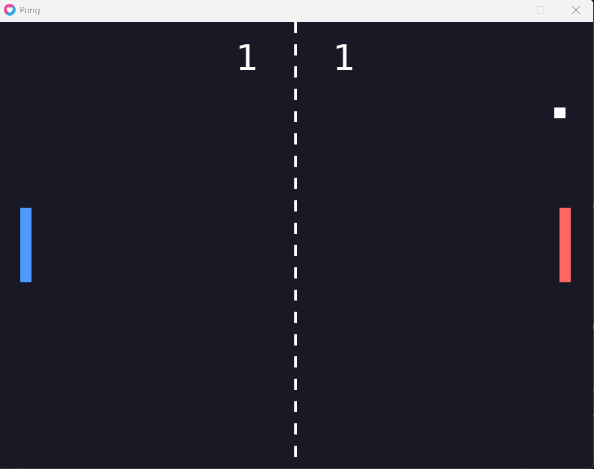

# Pong (Love2D)

**Name:** Beesan Jian
**University ID:** 12506085

## Description

This is a two-player Pong game made with Lua and the Love2D framework. Two players each control a paddle on opposite sides of the screen and try to keep a bouncing ball in play. The ball moves using velocity multiplied by delta time (`dt`), so it travels at the same speed on any computer. It bounces off the top and bottom walls and off both paddles, which are detected with AABB rectangle collision. When the ball goes past a paddle, the other player scores a point and the ball restarts in the center. There is also a dashed line in the middle of the court. The project was built to practice `love.load`, `love.update(dt)`, `love.draw`, keyboard input, and Git/GitHub.

## How to Run

1. Install [Love2D](https://love2d.org/) (version 11.x).
2. Open a terminal in the project folder and run:

```
love .
```

## Controls

| Player | Move up | Move down |
|--------|---------|-----------|
| Left paddle | W | S |
| Right paddle | Up arrow | Down arrow |

## My Own Changes

**1. Different color for each paddle.** The left paddle is blue and the right paddle is red, so it is easy to tell the players apart. Each player table has a `color` value, and `love.draw` sets that color before drawing the paddle, then sets it back to white for the ball.

**2. The ball speeds up after every paddle hit.** Each time the ball hits a paddle, its horizontal speed is multiplied by `1.05` (the `SPEED_UP` constant in `main.lua`), so rallies get faster and harder the longer they last. After a point is scored the ball resets to the center at its starting speed.

## Screenshot



## Demo Video

[Watch the demo video](demo/demo.mp4)
